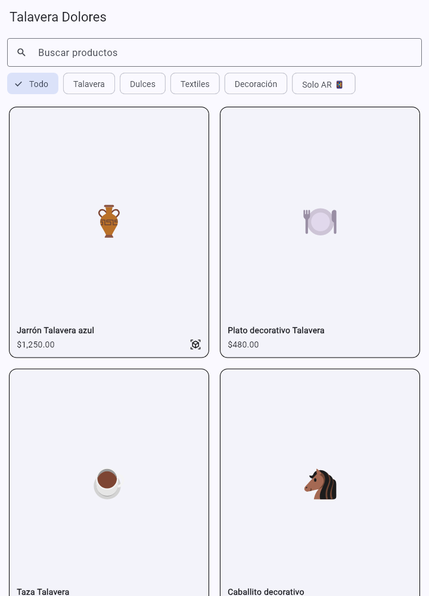
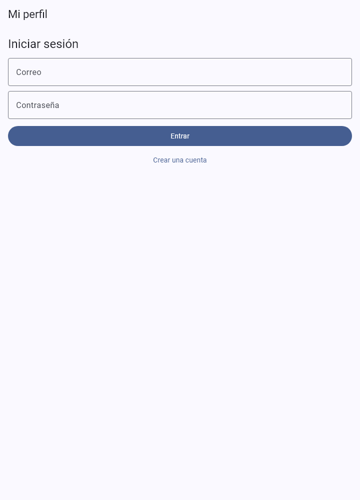
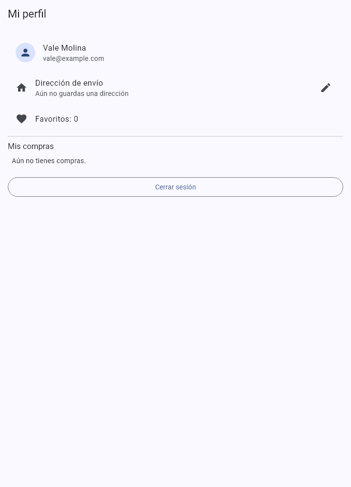
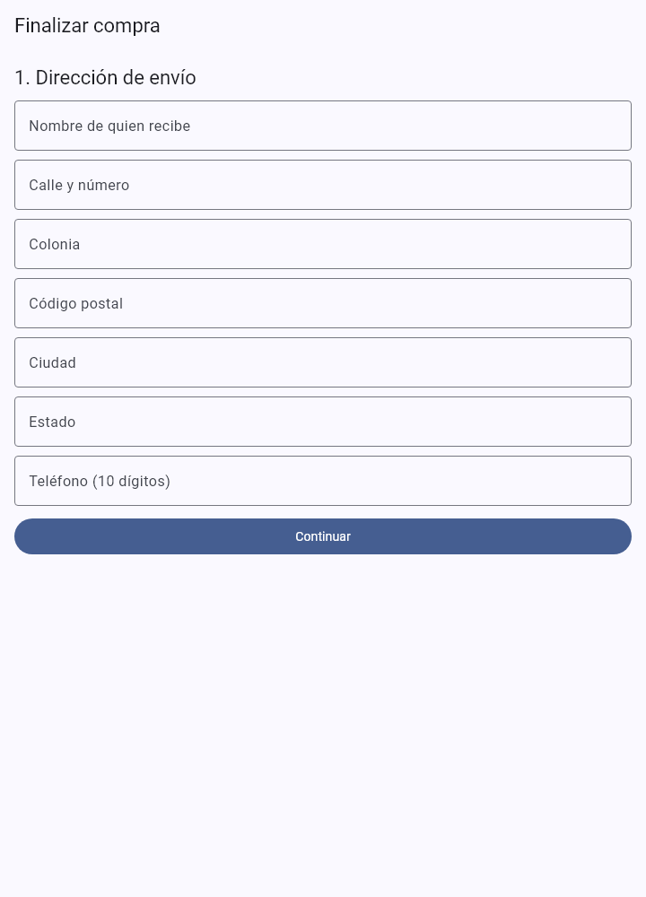
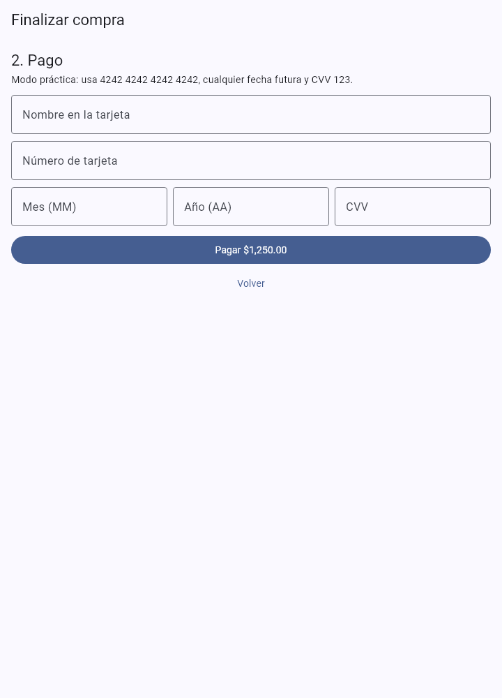
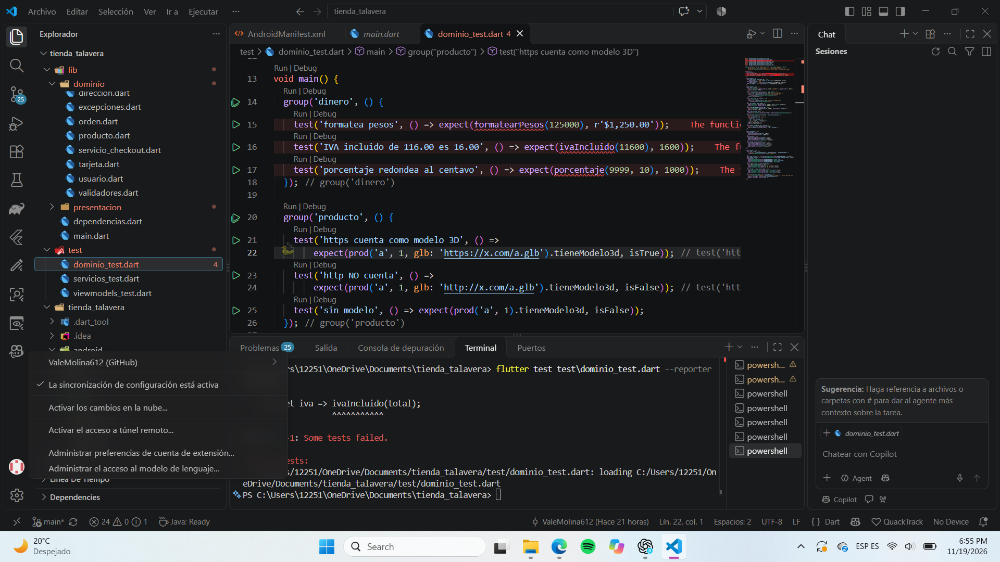

# Tienda Talavera Dolores

Aplicación móvil de comercio electrónico desarrollada con Flutter y TDD. Permite explorar artesanías de Dolores Hidalgo, consultar detalles, visualizar productos compatibles en 3D, administrar un carrito, iniciar sesión y completar una compra simulada.

**Desarrollado por [ValeMolina612](https://github.com/ValeMolina612)**  
**Repositorio:** [ValeMolina612/tienda_talavera](https://github.com/ValeMolina612/tienda_talavera)


> Proyecto académico de Desarrollo Móvil Integral, UTNG. La pasarela de pago y el servidor de cuentas son simulados; no se procesa dinero real.

## Funcionalidades

- Catálogo con búsqueda, categorías y filtro de productos con realidad aumentada.
- Detalle de producto, existencias, dimensiones y favoritos.
- Visor 3D y opción **Ver en tu espacio** mediante `model_viewer_plus`.
- Carrito persistente, control de existencias, cupones y envío gratis desde $800.
- Registro, inicio de sesión, bloqueo por intentos y almacenamiento seguro de sesión.
- Checkout con dirección, validación de tarjeta, idempotencia y revalidación de precios.
- Historial de compras y perfil del usuario.
- Dinero almacenado como centavos enteros para evitar errores de precisión.

## Evidencias de las fases de la aplicación

Las capturas se generaron directamente desde las pantallas del proyecto, con un tamaño completo de 720 × 1000 píxeles.

### Fase 1 Catálogo

Búsqueda de productos, filtros por categoría y selección de artículos compatibles con AR.



### Fase 2 Detalle del producto y realidad aumentada

Muestra precio, descripción, medidas, existencias, favoritos, acceso al visor 3D y la acción para agregar al carrito. La AR real requiere un teléfono físico compatible con ARCore o AR Quick Look.


### Fase 3 Carrito

Permite modificar cantidades, aplicar cupones y consultar subtotal, envío, total e IVA incluido.


### Fase 4 Registro e inicio de sesión

Acceso a la cuenta mediante correo y contraseña, con opción para crear un nuevo usuario.



### Fase 5 Perfil del usuario

Presenta datos de la cuenta, dirección, favoritos, historial de compras y cierre de sesión.



### Fase 6 Dirección de envío

Primer paso del checkout con validación de destinatario, domicilio, código postal y teléfono.



### Fase 7 Pago simulado

Segundo paso del checkout. La tarjeta se valida con Luhn y los datos sensibles no se almacenan.



### Fase 8 Confirmación de compra

La compra aprobada genera una orden, muestra la referencia del pago y descuenta las existencias.


## Evidencias del ciclo TDD en la terminal

Las siguientes capturas fueron tomadas directamente en Visual Studio Code con el proyecto `tienda_talavera` abierto. En ambas se observan el código de las pruebas, la terminal integrada y la cuenta **ValeMolina612 (GitHub)**.

### Fase roja

Siguiendo el manual, primero se comprueba que las pruebas fallen antes de disponer de la implementación. Para obtener esta evidencia se retiró temporalmente `lib/dominio/dinero.dart`, se ejecutó `flutter test test\dominio_test.dart --reporter expanded` y la terminal mostró **Some tests failed**. Inmediatamente después se restauró el archivo sin conservar cambios en el código.



### Fase verde

Después de restaurar la implementación se ejecutaron `dominio_test.dart`, `servicios_test.dart` y `viewmodels_test.dart`. La terminal mostró **+60: All tests passed!**.


### Código y cuenta de GitHub

Vista completa del proyecto en Visual Studio Code con `lib/main.dart`, la terminal, el repositorio y la cuenta **ValeMolina612 (GitHub)** visibles.


## Ciclo TDD

El proyecto sigue el ciclo **Rojo → Verde → Refactor**:

1. **Rojo:** se escribe primero una prueba que falla y define el comportamiento esperado.
2. **Verde:** se implementa el código mínimo necesario para que la prueba pase.
3. **Refactor:** se mejora el diseño conservando todas las pruebas en verde.

Las 60 pruebas automatizadas están distribuidas en tres suites:

| Suite | Cobertura principal |
| --- | --- |
| `test/dominio_test.dart` | Dinero, productos, carrito, validadores y tarjetas |
| `test/servicios_test.dart` | Pagos, checkout, idempotencia, cuentas y seguridad |
| `test/viewmodels_test.dart` | Catálogo, carrito, sesión y checkout |

```bash
flutter test --reporter expanded
```

Resultado verificado: **60 pruebas aprobadas**.

## Rondas de desarrollo

1. Preparación del proyecto.
2. Dinero y producto.
3. Excepciones y carrito.
4. Validaciones, dirección y usuario.
5. Tarjetas, Luhn y PCI.
6. Contratos, pasarela e idempotencia.
7. Checkout y revalidación de precios.
8. Cuentas y perfil de usuario.
9. ViewModels.
10. Pantallas.
11. Visor 3D y realidad aumentada.
12. Preparación para producción.

## Arquitectura

```text
lib/
├── dominio/       Reglas del negocio y contratos
├── datos/         Repositorios, persistencia y servicios simulados
├── presentacion/
│   ├── vm/        ViewModels con ChangeNotifier
│   └── pantallas/ Interfaz de usuario
├── dependencias.dart
└── main.dart
```

Las dependencias apuntan hacia el dominio. Las reglas del negocio no conocen Flutter, la base de datos ni la pasarela de pago, por lo que se pueden probar rápidamente y sustituir las implementaciones externas.

## Instalación y ejecución

```bash
git clone https://github.com/ValeMolina612/tienda_talavera.git
cd tienda_talavera
flutter pub get
flutter test
flutter run
```

Para Android se requiere el permiso de Internet en `android/app/src/main/AndroidManifest.xml`:

```xml
<uses-permission android:name="android.permission.INTERNET" />
```

## Datos de prueba

- Tarjeta aprobada: `4242 4242 4242 4242`
- Tarjeta rechazada: `4000 0000 0000 0002`
- Fecha: cualquier fecha futura
- CVV: `123`
- Cupón de 10 %: `DOLORES10`
- Cupón de 15 %: `TALAVERA15`

## Seguridad aplicada

- Contraseñas almacenadas con sal y hash en la simulación.
- Mensajes genéricos de autenticación para evitar revelar cuentas existentes.
- Bloqueo después de cinco intentos fallidos.
- Tokens en almacenamiento seguro y carrito en preferencias normales.
- Validación Luhn, marca, vigencia y CVV de la tarjeta.
- Claves de idempotencia para impedir cobros dobles.
- Revalidación de precios y existencias antes de cobrar.
- Limpieza del número de tarjeta y del CVV después del pago.

## Autor

**ValeMolina612**  
GitHub: [github.com/ValeMolina612](https://github.com/ValeMolina612)
