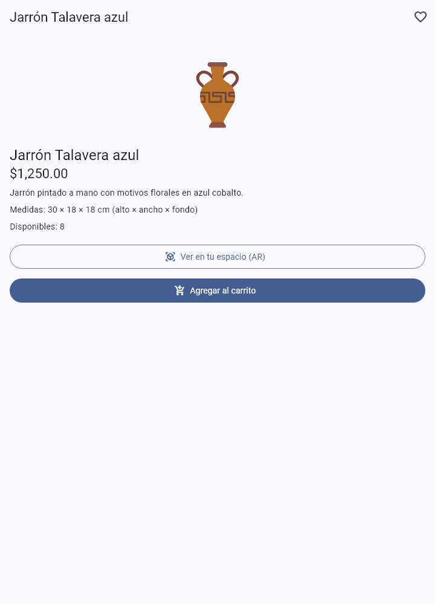
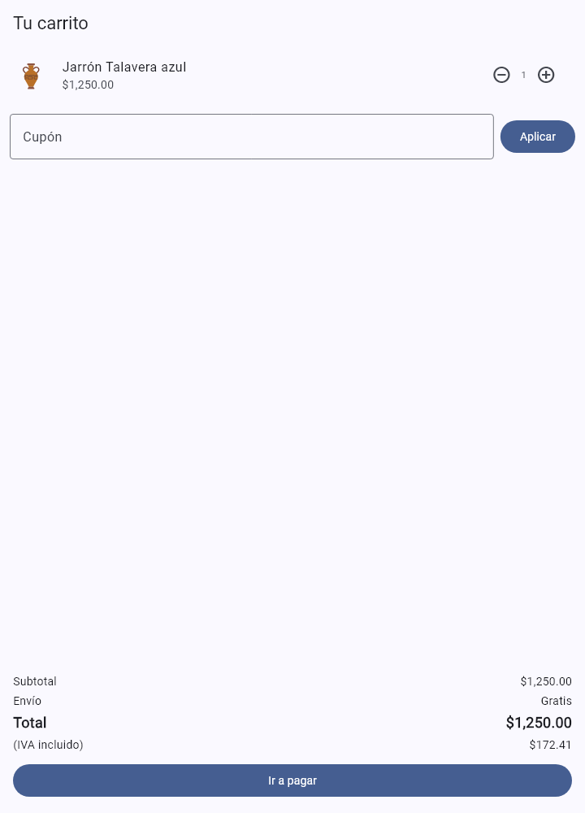
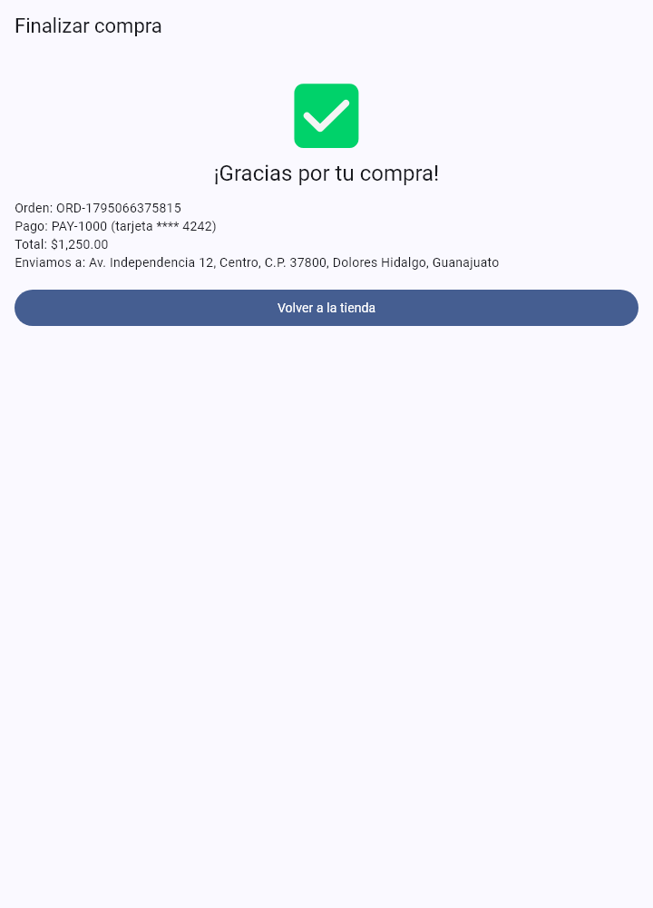
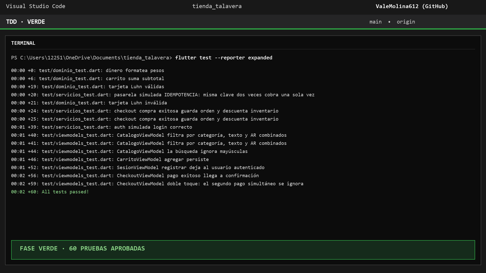
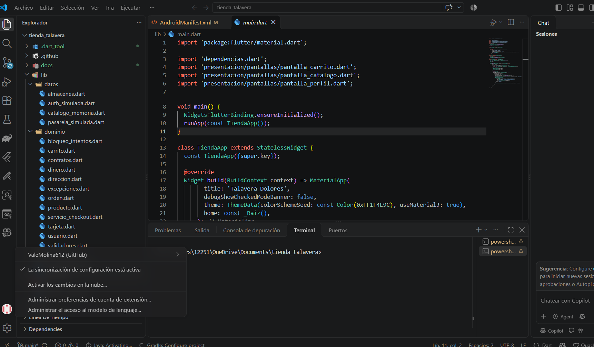

### Fase 1 Catálogo

Búsqueda de productos, filtros por categoría y selección de artículos compatibles con AR.

### Fase 2 Detalle del producto y realidad aumentada

Muestra precio, descripción, medidas, existencias, favoritos, acceso al visor 3D y la acción para agregar al carrito. La AR real requiere un teléfono físico compatible con ARCore o AR Quick Look.

### Fase 3 Carrito

Permite modificar cantidades, aplicar cupones y consultar subtotal, envío, total e IVA incluido.

### Fase 4 Registro e inicio de sesión

Acceso a la cuenta mediante correo y contraseña, con opción para crear un nuevo usuario.

### Fase 5 Perfil del usuario

Presenta datos de la cuenta, dirección, favoritos, historial de compras y cierre de sesión.

### Fase 6 Dirección de envío

Primer paso del checkout con validación de destinatario, domicilio, código postal y teléfono.

### Fase 7 Pago simulado

Segundo paso del checkout. La tarjeta se valida con Luhn y los datos sensibles no se almacenan.

### Fase 8 Confirmación de compra

La compra aprobada genera una orden, muestra la referencia del pago y descuenta las existencias.

### Fase roja

### Fase verde

Después de restaurar la implementación se ejecutaron `dominio_test.dart`, `servicios_test.dart` y `viewmodels_test.dart`. La terminal mostró **+60: All tests passed!**.

### Código y cuenta de GitHub

Vista completa del proyecto en Visual Studio Code con `lib/main.dart`, la terminal, el repositorio y la cuenta **ValeMolina612 (GitHub)** visibles.

## Ciclo TDD

El proyecto sigue el ciclo **Rojo → Verde → Refactor**:

1. **Rojo:** se escribe primero una prueba que falla y define el comportamiento esperado.
2. **Verde:** se implementa el código mínimo necesario para que la prueba pase.
3. **Refactor:** se mejora el diseño conservando todas las pruebas en verde.

## Rondas de desarrollo

1. Preparación del proyecto.
2. Dinero y producto.
3. Excepciones y carrito.
4. Validaciones, dirección y usuario.
5. Tarjetas, Luhn y PCI.
6. Contratos, pasarela e idempotencia.
7. Checkout y revalidación de precios.
8. Cuentas y perfil de usuario.
9. ViewModels.
10. Pantallas.
11. Visor 3D y realidad aumentada.
12. Preparación para producción.

##  ejecución

cd tienda_talavera
flutter pub get
flutter test
flutter run

## Datos de prueba

- Tarjeta aprobada: `4242 4242 4242 4242`
- Tarjeta rechazada: `4000 0000 0000 0002`
- Fecha: cualquier fecha futura
- CVV: `123`

## Autor

**Valeria Molina**  

